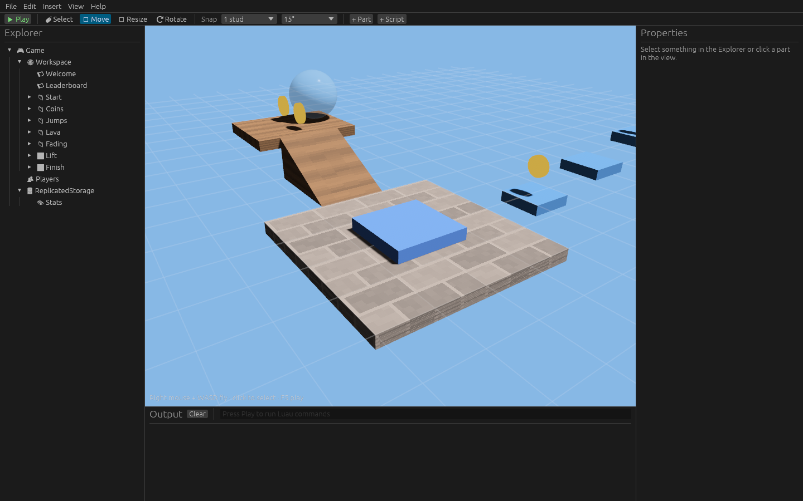

# PlayLibre

**Build voxel worlds together, and script them in Luau.**

PlayLibre is an open-source, multiplayer game-creation platform. Worlds are
built from blocks and parts, behaviour is written in [Luau](https://luau.org),
and the engine runs on [Bevy](https://bevy.org).

> **Status: early.** There is an editor where you can build a world, write
> scripts and press Play to test it with a character, or host it and have
> friends join from their own computers. Nothing is stable yet.




## Getting started

You need a recent stable Rust toolchain (`rustup update stable`).

On Arch Linux, Bevy's build needs a few system packages:

```sh
sudo pacman -S --needed base-devel pkgconf wayland libxkbcommon systemd-libs vulkan-icd-loader
# plus the Vulkan driver for your GPU, for example vulkan-radeon, vulkan-intel or nvidia-utils
```

On Debian or Ubuntu the equivalent is
`sudo apt install build-essential pkg-config libwayland-dev libxkbcommon-dev libudev-dev`.

Then:

```sh
cargo run -p playlibre                             # the PlayLibre app, opening on its home screen
cargo run -p playlibre-proto -- my_game.lrx        # play a saved game without the editor
cargo test --workspace                            # every test, no GPU needed
```

The first build compiles Bevy and takes a while. After that it is quick.

## The editor

- **File → Open a starter game → Kart race** loads an arcade kart race
  made only of parts and Luau scripts. Press **Play** (or F5), pick a
  track and press **START RACE**.
- **Layout:** the editor is laid out the way users of the reference editor know it.
  Along the top is a **File** menu and a ribbon with **Home**, **Model**,
  **Test** and **View** tabs. The **Toolbox** sits on the left, the
  **Explorer** sits top right with **Properties** under it, and the
  **Output** runs along the bottom. View shows or hides each panel. The
  shortcuts match Studio's too: Ctrl+1 to Ctrl+4 for Select, Move, Scale
  and Rotate, Ctrl+D to duplicate, Ctrl+G and Ctrl+U to group and ungroup,
  F to look at the selection, F5 to play and Shift+F5 to stop.
- **Toolbox** (left) holds ready-made parts, models (a character, a go-kart,
  a spawn), gameplay pieces and effects. Click one to add it, or search.
- **Explorer** (top right) shows the instance tree. Click to select, double-click
  a script to edit it, drag one item onto another to move it inside, and
  right-click for Insert, Rename, Duplicate and Delete. The Toolbox's
  **Character** drops in a dummy with a script that walks it back and forth,
  and **Go-kart** drops in a ready-to-drive kart.
- **Properties** (under the Explorer) edits the selection: name, position, orientation,
  size, shape, colour, material, anchored, can-collide, transparency, and so on.
- **Parts** come in four shapes (block, ball, cylinder, wedge) and eleven
  materials (plastic, smooth plastic, neon, metal, glass, wood, brick, grass,
  sand, rock, snow, water).
  Insert them from the Toolbox, Home > Part, or Model > Parts.
- **Viewport:** hold the right mouse button and use WASD/QE to fly (Shift is
  faster), scroll to move forward. Click a part to select it, then drag the
  handles to move, resize or rotate it (Ctrl+1 to Ctrl+4 switch tools, and
  Ctrl+R turns the selection 90°). Model > Snap to grid sets the move step
  and the rotation step.
- **Terrain tool** (Home > Terrain Editor, Ctrl+5): click and drag in the view to Add,
  Dig or Paint terrain with the chosen material and brush size. **Make a
  hill** builds a grassy hill (sandy edge, rock inside, snowy top) where the
  view is looking, and **Clear terrain** empties it. Brush strokes undo
  like any other edit.
- **Play / Stop:** Play starts every Script, then you join as `Player1` and
  your character spawns at the first SpawnLocation. If scripts give you a
  `leaderstats` folder, the leaderboard shows it in the top-right corner. Walk with WASD, jump with Space, turn the camera with
  the right mouse button. Stop (or Esc) puts the world back as it was.
- **Moving and the camera:** your character speeds up and stops quickly
  but smoothly, and turns to face where it walks the short way round
  instead of snapping. The camera starts behind you; the mouse wheel (or
  I and O) zooms from far out right into first person, where your own
  body is hidden, and `,` and `.` swing it round in steps. Walls between
  the camera and you pull it in so you never lose sight of your character.
- **Controllers and touch screens:** a game controller works as soon as
  it's plugged in: the left stick walks (and drives), the right stick
  looks round, A jumps, the right trigger clicks (it uses the tool in
  hand), X uses a prompt, Y takes out the first tool, the shoulder buttons
  swing the camera and the d-pad zooms. Touch the screen while playing and
  on-screen controls appear: a stick in the bottom left to walk, a jump
  button in the bottom right, drag anywhere else to look, pinch to zoom
  and tap to click (View → Touch controls shows them without touching).
  Scripts see `UserInputService.TouchEnabled`, `GamepadEnabled` and
  `GetLastInputType()`.
- **Haze, glow and colour:** an `Atmosphere` in Lighting thickens the
  distance into haze (Density, Haze, Color); a `BloomEffect` makes bright
  things glow (Intensity, Size, Threshold); a `ColorCorrectionEffect`
  changes Brightness, Contrast, Saturation and TintColor. Either effect
  also works inside the workspace's Camera. A `SelectionBox` outlines its
  Adornee (or its parent) in Color3, and a `Beam` draws a strip between
  its two attachments. `UISizeConstraint` and `UITextSizeConstraint` keep
  GUI objects and text within a minimum and maximum size.
- **Your own 3D models:** drop an `.obj` file on the window while editing
  and it's copied into the games folder's `meshes` folder and added as a
  part drawing that model, at the model's own size. Any part's `MeshId`
  can name an .obj file (looked for beside the game, in a `meshes` folder
  beside it, or in the games folder's `meshes` folder); the model is
  stretched to fit the part's Size, and it still bumps into things as
  that box. Players who join need the same file to see it.
- **Gradients:** a `UIGradient` inside a GUI object shades its background
  from one colour (and transparency) to another, turned `Rotation`
  degrees and shifted by `Offset`. Scripts set `Color` to a ColorSequence
  and `Transparency` to a NumberSequence; their first and last keypoints
  are used.
- **GUI on parts:** a `SurfaceGui` inside a part draws its frames, labels
  and buttons on one Face of the part (PixelsPerStud pixels to a stud),
  like a sign or a screen in the world, and its buttons can be clicked.
- **Sky and trails:** a `Sky` in Lighting draws the sun and moon along
  ClockTime's path (SunAngularSize, MoonAngularSize, CelestialBodiesShown)
  and stars at night (StarCount). A `Trail` leaves a fading ribbon behind
  its two attachments as they move, lasting Lifetime seconds.
- **Screen GUIs:** put a `ScreenGui` in StarterGui and fill it with frames,
  text labels and text buttons (Home > Object). They are drawn over the view
  while you edit, so you can click one to select it and lay it out with
  Position, Size and AnchorPoint. While playing, every player gets a copy,
  buttons can be clicked, and parts with a `ClickDetector` can be clicked too.
- **Tools:** put a `Tool` in StarterPack (the Toolbox's Tool gives it a `Handle` and
  a script). While playing, tools show on a hotbar at the bottom; press 1 to
  9 or click a slot to hold one, and click in the world to use it.
- **Floating text:** a `BillboardGui` inside a part holds labels that float
  above it and face the camera, like signs and name tags.
- **Lights:** a `PointLight` or `SpotLight` inside a part lights the world
  around it; they show best at night.
- **Text boxes and layouts:** a `TextBox` can be typed into while playing.
  A `UICorner` inside a GUI object rounds its corners, and a `UIListLayout`
  inside a frame stacks its other children in a column or row. A
  `ScrollingFrame` scrolls with the mouse wheel, and `UIGridLayout`,
  `UIPadding`, `UIStroke`, `UIScale` and `UIAspectRatioConstraint` can be
  inserted into the selected GUI object.
- **Attributes and tags:** the Properties panel lists the selection's
  attributes (numbers, text, booleans, vectors, colours) and tags, which you
  can add, change and remove. Both are saved with the game.
- **Saved data:** what a game's data stores save during a play test is kept
  beside the game's file (as `<name>.data.json`) and loaded next time you
  press Play. **File → Clear saved data** (or Test > Clear saved) forgets it.
- **Output** (bottom) shows `print`, `warn` and script errors. While playing
  you can type Luau into its command bar and press Enter.
- **Playing together:** **Test > Host** plays the game and lets others join.
  Once the bar along the top shows **Copy join code**, click it and send the code
  to friends: they paste it into **Test > Join** with a name and play from
  anywhere, with no port forwarding. The code connects the two computers
  directly over [iroh](https://www.iroh.computer), going through a relay
  only when home routers block a direct path, and is encrypted either way.
  When the host couldn't get a join code (no internet), Join also takes
  the host's address on your own network (and a port, if not 7420).
  That's encrypted too, but it can't check who's answering at that address
  the way a join code does: both computers show a safety code in the
  output, which only matches when nobody is listening in. While a game has
  a join code, it takes players only through it, and knows each by their
  key, so someone removed can't come back under another name. The host runs every `Script` and all the physics; each joined
  computer runs its own player's `LocalScript`s, moves its own character
  straight away (telling the host where it went), and shows the rest of the
  world as the host sends it. The bar along the top shows how many have joined. To
  host without a window, run `playlibre server mygame.lrx`, which prints a
  join code. Your player identity (a key made on first use) lives in
  `~/.config/playlibre/identity.key`.
- **Publishing:** **File → Publish…** puts the open game on the Hub with a
  title and a few words about it. It then shows on the home screen's
  **🌍 Online** tab under **Published games** for everyone,
  with **▶ Play** (play it on your own, no host needed) and **🌐 With
  friends** (host it so friends can join). Publishing the same file again
  puts out a new version; this computer keeps the secret that allows that
  in `~/.config/playlibre/published.json`. Published games stay up when
  you're away.
- **Accounts:** the home screen's **👤 Avatar** tab has **Your account**:
  claim a name on the Hub (3 to 20 letters, digits or underscores, one per
  Hub) and say a little about yourself. The account belongs to your
  identity key: every change is signed with it, so no one else can change
  it or publish as you. Games you publish show your account name, and
  clicking an author in Online lists all their games. Your account name is
  also the name you play as, unless you type another.
- **Passwords and signing in elsewhere:** under **Password** on the same
  tab, set a password (10 or more characters) to use your account on
  another computer or get it back if yours breaks. On the other computer,
  open **Already have an account?** and sign in with your name and
  password. The password is stretched with Argon2id on your computer and
  never sent: the Hub only keeps a copy of your key sealed with it, and
  hands that copy out only to someone who proves the password. Ten wrong
  passwords for a name lock signing in to it for 15 minutes. Signing in
  keeps this computer's old key beside the new one (`identity.key.old-…`).
- **Email:** making an account asks for an email, kept private, and the
  Hub mails it a 6-digit code to prove it's yours (type it on the Avatar
  tab, or the website's account page). Accounts made before ask for one.
- **More than one account:** **Sign out** at the top of **Your account**
  starts a new, empty account to claim another name or sign in with. Every
  account you've used is kept on this computer (in `accounts/` beside
  `identity.key`), and a **Switch to …** button swaps between them, no
  password needed.
- **Two-step sign-in and alerts:** with a password set, **Set up two-step
  sign-in** adds PlayLibre to an authenticator app (Google Authenticator,
  Authy, 1Password…); signing in elsewhere then also needs its 6-digit code,
  and each code works once. The account page lists recent sign-ins on other
  computers and where they came from. New accounts work out a small puzzle
  on the player's computer first (a bot check), and whoever runs the Hub
  hands out verified badges (`playlibre-hub verify <name>`).
- **Names no one else can take:** a name stays yours on that Hub, whatever
  the case (`Admin`, `admin` and `ADMIN` are one name). Every account also
  gets a number in the order it joined, starting at 0, and profile links
  use it. A name you give up stays yours to take back for 30 days, so
  no one can rename into it and pass for you. One address can make 5
  accounts an hour, and every address is limited in how fast it calls the
  Hub, publishes, shares and reports.
- **Catalog:** make a hat in the editor from up to 32 parts (each at most
  6 studs across), select its model and use **Model > Share as hat**. Its
  bottom sits on the character's head, centred. It goes in the catalog on
  the Hub, signed as you, and everyone using that Hub sees it on the
  **👤 Avatar** tab under **Catalog** with a **Wear** button. A worn catalog
  hat goes with you into every game, including ones you join. Everything
  in the catalog is free.
- **Safety:** bad words in chat come out as `#`s (the starter games'
  chat, and `TextService:FilterStringAsync` for any game's scripts), and
  player names with bad words become `Player`. A host can remove a joined
  player from **Players** on the bar along the top, and scripts can call
  `player:Kick(reason)`; a removed player can't rejoin that game. Every
  published game and catalog hat has a **⚑** to report it. Once three
  different players report something, the Hub stops listing it until
  whoever runs the Hub looks: `playlibre-hub reports` lists reports,
  `playlibre-hub clear game <id>` lists one again, and
  `playlibre-hub remove game <id>` takes it down (`item` for hats).
- **Editing together:** **Test > Edit together → Share this game**
  lets others edit the game you have open, live, while you work on it. Send
  them the code from **📋 Copy edit code** (or, on your own network, your
  address, then `#` and the password from **📋 Copy edit password**; the
  port is 7421): they paste it into **Edit together…** under Join. Nobody
  gets in without the code or password, and you still let each person in
  by name (**Let in** or **Turn away** on the bar along the top) before
  they see anything. Then your game, scripts and all, replaces the one
  they had open. Each share gets a new code and password.
  Everything anyone changes (parts, scripts, terrain, properties, adding and
  removing) shows up for everyone a moment later. When two people change
  the same thing at once, the last change to reach the sharing computer
  wins. Only the sharing computer saves the game. Playing a game is still
  done on your own; editing together carries on when you stop.
- **Finding games:** **🌍 Browse** lists the games being hosted right now,
  community servers first, and joins one with a click. There is one Hub
  and everyone uses it; the app can't run its own. (For trying a Hub out
  on one computer, such as the demo Hub, `PLAYLIBRE_HUB=host:port` points
  the app at it.)
- **One app, one home screen:** the build is a single `playlibre` program
  (`cargo run` starts it) and it opens on a home screen with tabs.
  **▶ Play** shows your games as tiles (the starter games and every saved game):
  pick one and press Play, or double-click it, or **Play with friends** to
  host it. **🌍 Online** lists the games being hosted, with a Join button
  each, and joins a friend's game from a pasted join code or address.
  **✏ Create** opens the editor on a new world, a starter game or a saved
  game. **More → 🌐 Host a server** hosts a game and plays it, or starts a
  server in the background with no player of your own (its join code stays
  hidden until you press Show IP). **👤 Avatar** picks your skin, shirt and
  trouser colours and a hat (a cap, a tall hat, a crown, a halo or an
  antenna); you look like that in every game you play, host or join, and
  other players see it. The PlayLibre mark at the left of the top bar is
  Home; Search and who you play as (your account's name, which can't be
  typed over) sit at the right. Games
  played from the home screen show only the game: **⏹ Leave game** (or Esc)
  goes back, and **File → Main menu** does from the editor. (For scripts
  and servers without a screen, `playlibre server <game.lrx>` and
  `playlibre help` still work.)
- **Home and Friends:** the home screen opens on **Home**: your friends
  along the top (a green dot when they're online, blue with the game's name
  when they're in one; click one in a game to join them), then every game
  with how many people play it right now. Click a game for its page: a big
  **Play** button that drops you into the best server (one with friends in
  it first, then the busiest with room, or starts a new one if none are
  running), **New server** to host your own, and the list of its servers,
  each with its players, its ping measured from your computer and a Join
  button, with the servers your friends are in on top. **Friends** finds
  people by name, sends and answers friend requests, and lists every
  friend with where they are. Friends need a name claimed on the Avatar
  tab. Try it all on one computer with
  `cargo run -p playlibre --example hub_demo` and
  `PLAYLIBRE_HUB=127.0.0.1:7431 cargo run -p playlibre`, which fills a Hub
  with pretend friends and servers.
- **How the Hub and game servers split the work:** the Hub is one small
  program (axum and SQLite) that only keeps lists: accounts, friends and
  requests, who's online and in which server, and the live servers of each
  game. It never runs a game or carries its traffic. Games run on whoever
  hosts them, a player pressing Host or a server left running with
  `playlibre server game.lrx --game-id <id>`, and each host tells the Hub
  every 15 seconds which game it runs, how many play and its join code;
  one that stops drops off. Players connect straight to the host, and the
  app pings each host itself for the ping column. Everything a player
  changes on the Hub (friend requests, where they are) is signed with
  their identity key, and only you can read your friends list and where
  your friends are. Hosts sign their listing too, so server lists show
  "hosted by" with the account the Hub checked, whatever the server is
  called. Accounts, passwords and friends live in the Hub's SQLite file
  (`hub.sqlite` on the Hub's server, or `--data` for `playlibre-hub`),
  so they outlast a restart.
- **One official Hub:** every copy of the app uses `https://hub.playlibre.net`
  (`OFFICIAL_HUB` in `crates/playlibre-hub/src/lib.rs`) for accounts, friends, publishing
  and server lists; the app never runs a Hub of its own. Whoever runs it
  owns it: only its owners list Official servers, and `playlibre-hub ban`, `owners` and
  `accounts` look after it from its own computer.
  [docs/OFFICIAL_HUB.md](docs/OFFICIAL_HUB.md) covers running one with
  HTTPS. Forks set their own.
- **Starter games:** small finished games to play or build on. Open them
  from the home screen or **File → Open a starter game**.
  - **Kart race** is an arcade kart racer for up to eight: you and
    whoever is in the server, with computer racers (Easy, Normal or Hard)
    filling the grid. Pick one of three tracks (Sunny Meadow, Dusty
    Canyon's figure eight with a bridge, and Frosty Peaks) and 1, 3 or 5
    laps, then press **START RACE**; with friends in the server everyone
    votes for a track. W/S or the arrows drive, A/D steer, hold Space or
    Shift while steering to drift (hold it longer, steering into the bend,
    for a blue, orange or pink mini-turbo when you let go), and E uses an
    item. A controller drifts with the right trigger and uses items with X;
    on a touch screen there are DRIFT and ITEM buttons. Hold the throttle
    from "2" on the countdown for a rocket start, and press drift off a
    ramp for a trick boost. Boost pads, item boxes and seven items: Turbo,
    Turbo x3, Bumper (bounces off walls), Seeker (chases the racer ahead),
    Slime (dropped behind you), Overdrive (fast, and knocks karts away)
    and Storm (spins out everyone ahead). The HUD shows your place, lap,
    time, item, a map and everyone's places; finishing scores points on
    the leaderboard. A humanoid whose `JumpPower` is 0 can't jump out of
    its seat, which is how the race keeps you in your kart.
  - **Chess** is a whole chess game made only of GUI objects and Luau
    scripts, to show what the engine can do. Play eight computer players
    (Droplet at about 250 up to Zenith at about 2300), with take-backs and
    hints; or press **Find a game** to be paired with someone else in the
    server, or challenge them by name. Clocks from 1+0 to 15+10, draws and
    resigning, rematches, preset chat lines, watching other games, and an
    Elo rating per player that is saved with the game's data. The
    computer's search (alpha-beta with a transposition table, quiescence,
    null moves and late move reductions) shows its depth, score and best
    line as it thinks, beside a bar for who is winning.
  - **Checkers**, **Connect 4** and **Kings in the Corner** (the card
    game, for 2 to 4 players) are table games made the same way. They
    share one table server and one screen (`crates/playlibre/src/table_games/`):
    a menu with a big **Play** button against an Easy, Medium or Hard
    computer player, or **Find a game** and **Play** buttons to sit down
    with people in the server. Wins are saved with the game's data.
- **Languages:** the home screen and the editor's menus, ribbon, panels
  and dialogs are in English, Chinese (Simplified), Spanish, Portuguese
  (Brazil) and French, following the computer's language until you pick
  one with the 🌐 button on the top bar. Class, property and enum names,
  and Luau, stay as they are in every language (as in the reference editor), so
  scripts and place files work the same. The help shown for each class is
  translated too, with the code in it left as it is. Chinese uses the computer's own Chinese font
  (Microsoft YaHei, PingFang, Noto Sans CJK or WenQuanYi); without one, it
  can't be picked. Translations live in `crates/playlibre/assets/lang/`,
  one file per language, keyed by the English text.
- **Screen readers:** on Windows, macOS and Linux, the home screen, menus
  and editor panels are read out by Narrator, VoiceOver or Orca, and Tab
  moves between buttons. The 3D world itself isn't described yet, and
  phones and tablets don't support screen readers yet.
- **Undo/redo** with Ctrl+Z and Ctrl+Y. **Save** with Ctrl+S. Games are
  saved as `.lrx` files in `~/Projects/playlibre-games/` by default.
- **Unsaved work is kept:** while a game has changes that aren't saved, a
  copy is written every minute (to `recovery/` in PlayLibre's settings
  folder, `~/.config/playlibre/` on Linux and macOS). If the app crashes or
  closes first, the next start offers to open the copy. Saving deletes it.

## Bringing in games from the reference editor

PlayLibre opens your own files from the reference editor: places (`.rbxl` and `.rbxlx`)
and models (`.rbxm` and `.rbxmx`), saved in either the binary or the XML format.

- **Open a place:** use File > Open, type its path on the Create tab, put it
  in the games folder so it shows up there, drop it on the window, or run
  `cargo run -- path/to/place.rbxl`.
- **Add a model to your game:** drop the model file on the editor window.

When you save, the game is written as a new `.lrx` file, so your original file
is never changed. The Output panel lists what came across and what didn't.

| What comes across | |
| --- | --- |
| Parts, spawn locations, seats | Position and rotation, size, colour, material, transparency, anchoring, collisions, shape. Wedge parts are wedges and corner wedges get their own model. |
| Unions | Their real carved shape, read from the file. A published union keeps its drawn shape online, so it shows its collision shape instead, which is close. |
| Mesh parts and special meshes | The mesh, when you put the mesh file in an `assets` folder (see below). Special meshes set to a sphere, cylinder or wedge change their part's shape. |
| Terrain | Every voxel of the place's terrain, as PlayLibre terrain. Each 4-stud voxel becomes 4 × 4 × 4 one-stud cells, and a half-full voxel at the surface fills its bottom half. |
| Scripts | Scripts, local scripts and module scripts, with their source. A script set to run on the client becomes a local script. |
| Containers | Models (with their primary part), actors, folders, every service PlayLibre has, and StarterPlayerScripts and StarterCharacterScripts. SoundService's sounds are kept in ReplicatedStorage. |
| GUIs | Screen, billboard and surface GUIs, frames, labels, buttons, text boxes, images, scrolling frames, and the UI layout, corner, stroke, padding, gradient and constraint objects. Viewport frames, canvas groups and video frames show as plain frames. |
| Look | Lighting (clock time, ambient, fog), sky, atmosphere, bloom, colour correction, sun rays, lights, particles, fire, smoke, sparkles, beams, trails, highlights, decals and textures. |
| Physics | Welds, motors, weld constraints, hinges, springs, ropes, rods, prismatic and ball-socket joints, attachments, and the body movers and constraint movers. |
| Data | Values, attributes and CollectionService tags. |

### Your meshes, pictures and sounds

A file from the reference editor names its meshes, pictures and sounds by asset
number, such as `rbxassetid://1234567`, and the files themselves live online.
PlayLibre never downloads them. Put your own copies in a folder called `assets`
next to the place file (or in the games folder), named by their number:

```
my-game.rbxl
assets/
  1234567.mesh     a mesh (a .mesh file from Studio, or an .obj)
  2345678.png      a picture (.png or .jpg)
  3456789.ogg      a sound (.ogg, .mp3 or .wav)
```

A file with no ending, just the number, works too. Anything not found shows
as before: a mesh part as a box, a picture as nothing, a sound silent.

| What's still different | |
| --- | --- |
| Shapes | Unions, mesh parts and trusses collide with their real shape (a union's own collision pieces, a model's separate pieces, a truss as a solid box). Union and subtraction made by a script while playing (`UnionAsync`, `SubtractAsync`) can't carve: a union becomes one part over all of them and a subtraction keeps the part. A special mesh's file is stretched to its part's size, ignoring its `Scale`. |
| Terrain | Terrain saved in Studio's newer separate-asset format (expanded terrain) can't be read: the open-source readers leave that data out, so it's left out and the Output panel says so. Terrain is drawn in 1-stud cells, smoothed, rather than the reference platform's 4-stud voxels; `ReadVoxels` and `WriteVoxels` work in the reference platform's units. |
| Animations | Animations kept online (`rbxassetid://`) can't be fetched, so their tracks play silently for a second (scripts that play, wait for and stop them still run). PlayLibre's built-in `playlibre://` ones move the character. |
| Other classes | API classes PlayLibre has no engine side for (animation controllers, handle adornments, localization tables and so on) keep their class name and every property, so scripts read and set them as on the reference platform. Dialogs show a "Talk" prompt and their conversation. |
| Online things | Purchases, badges, teleports, other players' avatars and `InsertService:LoadAsset` need the reference platform's servers, so they answer as if nothing was bought or found. |
| Sound | Sounds play from the `assets` folder; effects such as reverb and equalizers are kept but not heard. |

## Layout

| Crate | What it is |
| --- | --- |
| [`playlibre-instance`](crates/playlibre-instance) | The instance tree: classes, typed properties, parenting, destroy, a change journal, and the `.lrx` file format. No engine dependencies. |
| [`playlibre-hub`](crates/playlibre-hub) | The Hub: a small self-hostable server (axum and SQLite) that lists live games per game, accounts, friends and who's online, and the client and background announcer the app uses. |
| [`playlibre-net`](crates/playlibre-net) | Player identity (a keypair) and join codes. Carries a hosted game between computers over iroh, peer to peer with a relay fallback. |
| [`playlibre-script`](crates/playlibre-script) | The sandboxed Luau runtime (via `mlua`) with a thread scheduler. Every name scripts can see lives in [`names.rs`](crates/playlibre-script/src/names.rs). |
| [`playlibre-rbx`](crates/playlibre-rbx) | Opens place and model files saved by the reference editor (`.rbxl`, `.rbxlx`, `.rbxm`, `.rbxmx`) as instance trees, using the open-source rbx-dom readers. |
| [`playlibre-engine`](crates/playlibre-engine) | Play sessions: physics, the player character, touch events, respawning, and the Bevy integration (rendering and cameras). |
| [`playlibre`](crates/playlibre) | The PlayLibre app: the home screen (Play, Online, Create, Host), the editor, plus `playlibre server`. |
| [`playlibre-proto`](crates/playlibre-proto) | A minimal player that runs a saved game or a single script. |

See [docs/ARCHITECTURE.md](docs/ARCHITECTURE.md) for how the pieces fit together.

## Scripting API

Scripts use a familiar scene-graph style: an `Instance` tree rooted at
`game`, a `workspace`, value types like `Vector3` and `Color3`, services from
`game:GetService`, and signals with `:Connect`. What exists today:

- **Globals:** `game`, `workspace`, `script`, `Instance.new(class, parent?)`,
  `Vector3.new/zero/one`, `Vector2`, `Color3.new/fromRGB`, `CFrame`, `UDim2`,
  `TweenInfo`, `RaycastParams`, `Enum`, `require`, `print`, `warn`, `time()`, `task.wait`,
  `task.spawn`, `task.delay`, and `wait`.
- **Classes:** `Part`, `SpawnLocation`, `Model`, `Folder`, `Script`,
  `LocalScript`, `ModuleScript`, `Humanoid`, `IntValue`, `NumberValue`,
  `StringValue`, `BoolValue`, `ClickDetector`, `ProximityPrompt`,
  `RemoteEvent`, `BindableEvent`, `RemoteFunction`, `BindableFunction`, `ObjectValue`, `Vector3Value`, `Color3Value`, `ScreenGui`, `Frame`, `TextLabel`,
  `TextButton`, `TextBox`, `ScrollingFrame`, `UICorner`, `UIListLayout`,
  `UIGridLayout`, `UIPadding`, `UIStroke`, `UIScale`,
  `UIAspectRatioConstraint`, `BillboardGui`,
  `Tool`, `PointLight`, `SpotLight`, `Explosion`, `Camera`, plus the built-in `Workspace`,
  `Players` (with one `Player` each, holding a `PlayerGui` and a
  `Backpack`), `ReplicatedStorage`, `ServerStorage`, `StarterPlayer`, `ServerScriptService`, `StarterGui`,
  `StarterPack` and `Lighting`.
- **Instance members:** `Name`, `ClassName`, `Parent`, `FindFirstChild`,
  `FindFirstChildOfClass`, `FindFirstAncestor`, `FindFirstDescendant`,
  `WaitForChild`, `GetChildren`, `GetDescendants`, `ClearAllChildren`, `IsA`,
  `IsDescendantOf`, `GetFullName`, `Clone`, `Destroy`, `instance.ChildName`,
  `GetPropertyChangedSignal(name)`, and the `Changed`, `ChildAdded`,
  `ChildRemoved`, `DescendantAdded`, `DescendantRemoving` and `Destroying`
  events. Parts also have `Touched` and `TouchEnded`.
- **Attributes:** `SetAttribute(name, value)` (nil removes it),
  `GetAttribute`, `GetAttributes`, `GetAttributeChangedSignal(name)` and the
  `AttributeChanged(name)` event. Values can be booleans, numbers, strings,
  `Vector3`, `Vector2`, `Color3` and `UDim2`.
- **Tags:** `AddTag`, `RemoveTag`, `HasTag` and `GetTags` on any instance,
  and `CollectionService:GetTagged(tag)`, `GetInstanceAddedSignal(tag)` and
  `GetInstanceRemovedSignal(tag)`.
- **Tools:** tools in StarterPack are copied into each player's `Backpack`
  when their character spawns. Holding one moves it into the character and
  puts its `Handle` part in their hand. A tool fires `Equipped(mouse)`,
  `Unequipped`, and `Activated` / `Deactivated` on click while `Enabled`.
  `Humanoid:EquipTool(tool)` and `UnequipTools()` do it from a script.
- **Mouse:** `Player:GetMouse()` gives `Hit` (a CFrame where the pointer
  meets the world), `Target` (the part under it), `X`, `Y`, and the
  `Button1Down` / `Button1Up` events.
- **Camera:** `workspace.CurrentCamera` has `CFrame`, `FieldOfView`,
  `CameraType` (`Custom` follows the character, `Scriptable` stays where
  scripts put it, and tweens work on it), `ViewportSize` and
  `WorldToViewportPoint(point)`.
- **Moving parts:** `AssemblyLinearVelocity` reads or sets how fast a part
  (or a character's root part) is moving, `ApplyImpulse(vector)` pushes it,
  and `GetMass()` says how heavy it is.
- **Explosions:** an `Explosion` (`Position`, `BlastRadius`,
  `BlastPressure`) goes off when it is put in the workspace. Its `Hit` event
  fires with each part in reach and the distance; characters in reach die
  and loose parts are thrown.
- **Text boxes:** `TextBox` has `Text`, `PlaceholderText` and
  `ClearTextOnFocus`, the `Focused` and `FocusLost(enterPressed)` events, and
  `CaptureFocus`, `ReleaseFocus` and `IsFocused`.
- **Layout helpers:** `UICorner.CornerRadius` and `UIListLayout.Padding` are
  `UDim`s (`UDim.new(scale, offset)`); `UIListLayout.FillDirection` is
  `Vertical` or `Horizontal`, and items go in `LayoutOrder` order.
  `UIGridLayout` has `CellSize`, `CellPadding` (`UDim2`s) and
  `FillDirection`. `UIPadding` has `PaddingLeft`, `PaddingRight`,
  `PaddingTop` and `PaddingBottom`. `UIStroke` outlines its parent (or its
  text, for a text object) with `Color`, `Thickness`, `Transparency` and
  `Enabled`. `UIScale.Scale` grows its parent and `UIAspectRatioConstraint`
  keeps its `AspectRatio` (width over height).
- **Images:** `ImageLabel` and `ImageButton` (which has `MouseButton1Click`
  and `Activated` like a text button) show the PNG named by `Image`. A plain
  name is looked for beside the game file, in an `images` folder beside it,
  and in `~/Projects/playlibre-games/images`. Built in are `playlibre://coin`,
  `smile`, `star`, `arrow` and `checker`, and the table games' pictures:
  chess pieces (`chess-wk` and so on, and wooden ones, `chess-wood-wk`),
  draughts pieces (`draughts-white`, `draughts-wood-white-king` and so on),
  cards (`card-qh`, `card-back`, `baize`) and Connect 4 tiles (`c4-red`).
  `ImageColor3` tints it, `ImageTransparency` fades it, and `ScaleType` is
  `Stretch`, `Fit` or `Crop`. Joined computers need the same files.
- **Terrain:** `workspace.Terrain` is ground made of one-stud cells, each
  grass, sand, rock, snow or another material. It's drawn smooth: hills
  slope and balls of ground come out round rather than as stacks of cubes
  (what you walk on is still the cells, so flat ground lines up exactly). `Terrain:FillBlock(cframe,
  size, material)`, `FillBall(centre, radius, material)` and
  `FillCylinder(cframe, height, radius, material)` fill it, filling with
  `Enum.Material.Air` digs, and `Clear()` empties it. Characters walk up
  one-stud steps, things land on it and fall into holes, `workspace:Raycast`
  hits it (with the cell's `Material`), it's saved in the game file, and
  joined computers get it. `Enum.Material.Water` cells are see-through:
  loose parts float in them, rays pass through, and characters swim (they
  drift up and tread water at the top, Space swims up, and Space at the top
  leaps out). The sample has a hill behind the start and a pool beside the
  vault.
- **Pictures on parts:** a `Decal` inside a part stretches the PNG named by
  `Texture` over one `Face` (`Enum.NormalId`: Front, Back, Left, Right,
  Top, Bottom), and a `Texture` repeats it every `StudsPerTileU` by
  `StudsPerTileV` studs. `Color3` tints it and `Transparency` fades it.
  Names are found like an `ImageLabel`'s. The sample has an arrow sign, a
  star on the vault door and a checkered finish.
- **Sounds:** a `Sound` plays the WAV or OGG file named by `SoundId` (found
  like a picture) while `Playing` is true, at `Volume` and `PlaybackSpeed`,
  starting over when it ends if `Looped`. `Play` and `Stop` go back to the
  start, `Pause` and `Resume` don't, and `Ended` fires when it finishes.
  `playlibre://coin`, `jump`, `boom`, `click`, `splash`, `chime` and `hum`
  are made by PlayLibre, and so are four sets of game sounds, `wood`, `glass`,
  `retro` and `digital`, each with `move`, `capture`, `check`, `notify`,
  `victory`, `defeat`, `draw`, `lowtime`, `confirm`, `challenge` and
  `message` (`playlibre://glass/victory`), and `playlibre://table/drop`, `bad`,
  `win`, `lose` and `playlibre://cards/click`, `slide`, `win`, `lose`. A sound inside a part gets quieter further from the
  camera. Characters carry `Jumping` and `Splash` sounds in their root part,
  played when they jump and fall into water. In the sample, coins ding, the
  TNT booms and the finish chimes.
- **Real physics for loose parts:** unanchored parts are rigid bodies
  (using the [Rapier](https://rapier.rs) engine). Turned parts collide as
  their true shape, whichever way they face: crates stack, tumble off
  edges and land on a face, balls roll, wedges slide down slopes, and
  parts rub on what they rest on (plastic slides down steep slopes). A
  model welded together is one solid body, so it falls over as one piece.
  Characters still move the snappy way players expect, and shove the
  loose parts they walk into. When a character dies it falls apart: its
  head, body and limbs topple to the ground as loose pieces, hat and eyes
  still on its head, until it respawns.
- **Hinges, ropes and springs** are real joints in the physics engine.
  A hinge arm swings, and shoves loose things it runs into; a Servo
  holds its arm out against gravity at its `TargetAngle`. A rope or spring
  pulls at its attachments, so a plank hung by one end tips down to hang
  below it. Wheels on hinges really roll: on the ground they hold up a
  loose base, and a Motor drives it along without sliding sideways.
  A `PrismaticConstraint` is a slider (along its attachment's X axis,
  stopping at `LowerLimit` and `UpperLimit` when `LimitsEnabled`, and
  reporting `CurrentPosition`); with a `SpringConstraint` beside it that's
  suspension. A `BallSocketConstraint` is a ball joint that turns any way. Wheels turning at different speeds turn it like
  a tank, and a wheel can hang from a knuckle on a Servo hinge about the
  vertical, so setting the servo's `TargetAngle` steers. The sample's rover
  drives back and forth on the playground lawn.
- **Tool swings:** using a held tool (clicking with it)
  swings the arm holding it up and down, with the tool in the hand.
- **Scrolling frames:** `ScrollingFrame` has `CanvasSize` (`UDim2`),
  `CanvasPosition` (`Vector2`, changed by the wheel) and
  `ScrollBarThickness`; its children are placed on the canvas and clipped.
- **Lights:** `PointLight` and `SpotLight` have `Enabled`, `Brightness`,
  `Color` and `Range`; spot lights also have `Angle`.
- **Floating text:** `BillboardGui` has `Size` (`UDim2`, scale in studs plus
  pixels), `StudsOffset`, `AlwaysOnTop`, `MaxDistance` and `Enabled`, and
  shows the labels inside it over its parent part (or a model's `Head`).
- **Helpers:** `tick()`, `elapsedTime()`, `spawn`, `delay` and
  `task.defer(fn, ...)`; `Color3.fromHSV`, `Color3.fromHex`, `ToHSV`,
  `ToHex` and `Lerp`; `Vector3.xAxis`/`yAxis`/`zAxis`, `Min`, `Max`, `Abs`,
  `Floor`, `Ceil`, `Sign`, `FuzzyEq` and `Angle`; `FindFirstChildWhichIsA`,
  `FindFirstAncestorOfClass`, `FindFirstAncestorWhichIsA`, `IsAncestorOf`,
  `Players:GetPlayerByUserId`, and `game.PlaceId` / `game.JobId`.
- **Signals:** `Connect` (returns a connection with `Disconnect`), `Once`,
  and `Wait`, which pauses the script until the signal fires and returns its
  arguments.
- **CFrame:** `CFrame.new`, `CFrame.lookAt`, `CFrame.Angles`,
  `fromOrientation` and `fromAxisAngle`; `Position`, `LookVector`,
  `RightVector`, `UpVector`, `Inverse`, `Lerp`, `ToWorldSpace`,
  `ToObjectSpace`, `PointToWorldSpace`, `PointToObjectSpace`, `*` and `+`.
  Parts have a `CFrame`, and models have `GetPivot` and `PivotTo`.
- **TweenService:** `TweenService:Create(instance, TweenInfo.new(time, style,
  direction, repeats, reverses, delay), goals)` animates numbers, vectors,
  colours, `UDim2`s and `CFrame`s with eleven easing styles. Tweens have
  `Play`, `Pause`, `Cancel` and a `Completed` event.
- **GUIs:** `ScreenGui` (`Enabled`, `ResetOnSpawn`), and `Frame`,
  `TextLabel` and `TextButton` with `Position` and `Size` (`UDim2`),
  `AnchorPoint`, `BackgroundColor3`, `BackgroundTransparency`, `Visible`,
  `Text`, `TextColor3` and `TextSize`, plus `ZIndex` (higher draws on
  top), `BorderSizePixel`, `BorderColor3` and `ClipsDescendants`. Text
  objects also have `TextTransparency`, `TextXAlignment` (`Left`, `Center`,
  `Right`), `TextYAlignment` (`Top`, `Center`, `Bottom`), `TextWrapped` and
  `TextScaled`. Buttons fire `MouseButton1Click` and `Activated`, and every
  GUI object fires `MouseEnter` and `MouseLeave`. `LocalScript`s inside a GUI run for the player, and
  `Players.LocalPlayer` is that player.
- **Clicking parts:** a `ClickDetector` inside a part fires
  `MouseClick(player)` when the player clicks the part from within
  `MaxActivationDistance` studs.
- **Proximity prompts:** a `ProximityPrompt` inside a part shows a "press E"
  bubble when the player is within `MaxActivationDistance`. It has
  `ActionText`, `ObjectText`, `KeyboardKeyCode`, `HoldDuration` and
  `Enabled`, and fires `Triggered(player)` and `TriggerEnded(player)`.
- **Lighting:** `ClockTime` (0 to 24) moves the sun and colours the sky,
  `Brightness` sets how strong the sun is, `Ambient` tints the shadows (0.5
  grey is normal), and things further than `FogStart` studs fade into
  `FogColor` until they vanish at `FogEnd`.
- **Movers and constraints:** an `Attachment` is a point on a part
  (`Position` relative to the part, `WorldPosition` to read). With
  `Attachment0` set, `LinearVelocity` (`VectorVelocity`, `MaxForce`) pushes
  the part towards a velocity, `VectorForce` (`Force`) pushes it steadily,
  and `AlignPosition` pulls it to `Attachment1` or to `Position`
  (`Responsiveness`, `MaxForce`, `MaxVelocity`, `RigidityEnabled`).
  `RopeConstraint` (`Length`) and `SpringConstraint` (`FreeLength`,
  `Stiffness`, `Damping`) join two attachments, and are drawn when
  `Visible` (`Color`, `Thickness`). The older `BodyVelocity`, `BodyPosition`
  (`P`, `D`) and `BodyForce` work inside a part. Movers push whole welded
  assemblies.
- **Spinning and hinges:** loose parts spin with `AssemblyAngularVelocity`
  (radians a second about X, Y and Z; scripts read and set it), and slow
  down rubbing on the ground. `AngularVelocity` (`AngularVelocity`,
  `MaxTorque`, on `Attachment0`) and the older `BodyAngularVelocity`
  (inside a part) keep them spinning. `Torque` (`Torque`, about
  `Attachment0`'s axes) turns steadily. `AlignOrientation` turns
  `Attachment0` to face the way `Attachment1` does, or its `CFrame` when
  there's no `Attachment1` (`Responsiveness`, `MaxTorque`,
  `RigidityEnabled`), and the older `BodyGyro` (`CFrame`, `P`, `D`,
  `MaxTorque`) does the same inside a part. A `RodConstraint` holds two
  attachments exactly `Length` apart, and a `NoCollisionConstraint` lets
  its `Part0` and `Part1` pass through each other. A `HingeConstraint` lets
  `Attachment1`'s part, and everything welded to it, turn only about
  `Attachment0`'s X axis (attachments have an `Orientation` to aim it).
  `ActuatorType` None swings freely under gravity, `Motor` turns at
  `AngularVelocity` with up to `MotorMaxTorque`, and `Servo` turns to
  `TargetAngle` degrees at `AngularSpeed` with up to `ServoMaxTorque`.
  `CurrentAngle` reads the angle. Hinged parts stay on their hinge exactly,
  however fast they turn.
- **Effects:** a `ParticleEmitter` inside a part (or an attachment) sends
  out particles: `Rate`, `Lifetime` and `Speed` (`NumberRange.new(min,
  max)`), `SpreadAngle`, `Size`, `Color`, `Transparency`, `Acceleration`,
  `Drag`, `LightEmission`, and `Emit(count)` for a burst. `ColorSequence` and
  `NumberSequence` (with keypoints) are accepted and use their first value.
  `Fire` (`Size`, `Heat`, `Color`, `SecondaryColor`), `Smoke` (`Color`,
  `Opacity`, `RiseVelocity`, `Size`) and `Sparkles` (`SparkleColor`) are
  ready-made effects. A `Highlight` outlines and tints its `Adornee` (or
  its parent) with `FillColor`, `FillTransparency`, `OutlineColor` and
  `OutlineTransparency`. Effects are drawn while editing too.
- **Remote and bindable functions:** like events, but the caller waits for
  an answer. A `RemoteFunction`'s `InvokeServer(...)` is answered by the
  function a game script sets as `OnServerInvoke(player, ...)`, and
  `InvokeClient(player, ...)` by `OnClientInvoke`. A `BindableFunction`'s
  `Invoke(...)` is answered by `OnInvoke`. The answer may wait itself, errors
  in it reach the caller, and calling before an answer is set waits for one.
- **HttpService:** `JSONEncode(table)`, `JSONDecode(text)`,
  `GenerateGUID(braces?)` and `UrlEncode(text)`. (It doesn't fetch from the
  web.)
- **More value objects:** `ObjectValue` (a link to an instance),
  `Vector3Value` and `Color3Value`, besides the number, string and boolean
  ones.
- **ServerStorage and StarterPlayer:** `ServerStorage` keeps templates out of
  the world; `StarterPlayer.CharacterWalkSpeed` and `CharacterJumpPower` are
  what new characters start with. `workspace.FallenPartsDestroyHeight` (-100)
  is how low loose parts and characters can fall.
- **Input:** `UserInputService.InputBegan` and `InputEnded` fire with an input
  object (`KeyCode`, `UserInputType`) and whether the game's UI already used
  it. `IsKeyDown(Enum.KeyCode.X)` and `IsMouseButtonPressed` check what is
  held.
- **Raycasts:** `workspace:Raycast(origin, direction, params?)` returns the
  first part hit, with `Instance`, `Position`, `Normal`, `Distance` and
  `Material`, or nil. `RaycastParams` has `FilterDescendantsInstances` and
  `FilterType` (`Enum.RaycastFilterType.Exclude` or `Include`). Every part
  shape is hit exactly.
- **Animations:** every character's humanoid has an `Animator`.
  `animator:LoadAnimation(animation)` (or `humanoid:LoadAnimation`) loads an
  `Animation` whose `AnimationId` is a built-in one: `playlibre://wave`,
  `cheer`, `point`, `nod`, `shake`, `jacks` or `dance`. The track it gives
  has `Play(fadeTime?, weight?, speed?)`, `Stop(fadeTime?)`, `AdjustSpeed`,
  `AdjustWeight`, `IsPlaying`, `Length`, `Looped`, `Speed`, `TimePosition`
  and a `Stopped` event; `animator:GetPlayingAnimationTracks()` lists what's
  playing. Animations that don't move the legs let them walk as usual.
- **Pathfinding:** `game:GetService("PathfindingService"):CreatePath({
  AgentRadius = 1, AgentHeight = 5, AgentCanJump = true })` makes a path;
  `path:ComputeAsync(from, to)` searches the ground for a way round walls,
  up stairs and ramps, and up ledges it can jump, and `path.Status` says
  `Enum.PathStatus.Success` or `NoPath`. `path:GetWaypoints()` lists points
  with a `Position` and an `Action` (`Enum.PathWaypointAction.Walk` or
  `Jump`); walk a character through them with `Humanoid:MoveTo`. Other
  characters aren't avoided. AgentRadius is half the agent's width.
- **Finding parts in a space:** `workspace:GetPartBoundsInBox(cframe, size,
  params?)`, `GetPartBoundsInRadius(position, radius, params?)` and
  `GetPartsInPart(part, params?)` list the parts there (judged by their
  boxes, and balls as balls), and `part:GetTouchingParts()` lists the parts
  touching a part. `OverlapParams` has the same filter as `RaycastParams`,
  plus `MaxParts`.
- **How characters look:** every character has a `BodyColors` with
  `HeadColor3`, `TorsoColor3`, `LeftArmColor3`, `RightArmColor3`,
  `LeftLegColor3` and `RightLegColor3`; change them to recolour it. Hats are
  `Accessory` objects: their parts follow the head, placed by each part's
  `HeadOffset` attribute.
- **Remote and bindable events:** a `RemoteEvent`'s `FireServer(...)` reaches
  `OnServerEvent(player, ...)`; `FireClient(player, ...)` and
  `FireAllClients(...)` reach `OnClientEvent(...)`. A `BindableEvent`'s
  `Fire(...)` reaches its `Event`. With one player on one computer these
  arrive straight away and tables are passed as they are, not copied. In a
  hosted game, remote events go between computers: their values are copied
  (nil, booleans, numbers, strings, tables, instances, `Vector3`, `Vector2`,
  `Color3`, `CFrame`, `UDim`, `UDim2` and enum items; an instance the other
  side can't see arrives as nil), and `RemoteFunction:InvokeServer` waits for
  the host's answer. `FireClient` and `FireAllClients` only work on the host.
- **Saved data:** `DataStoreService:GetDataStore(name)` gives a store with
  `GetAsync`, `SetAsync`, `UpdateAsync`, `IncrementAsync` and `RemoveAsync`.
  Values can be nil, booleans, numbers, strings, and tables of those.
- **Debris:** `Debris:AddItem(instance, seconds)` destroys it later.
- **Part properties and events:** `Position`, `Orientation` (degrees),
  `Size`, `Shape` (`Enum.PartType`), `Color`, `Material` (`Enum.Material`),
  `Anchored`, `CanCollide`, `Transparency`, and the `Touched` event. Enum
  properties also accept a name, as in `part.Material = "Neon"`. `CanTouch`
  false stops `Touched`, `CanQuery` false hides it from raycasts and region
  searches, `CastShadow` false drops its shadow, `Reflectance` makes it
  shiny, `Locked` stops the editor picking it in the view, and `Massless`
  is kept. `BrickColor` (named colours, `BrickColor.new("Bright red")`)
  sets its colour too.
- **Collision groups:** `PhysicsService:RegisterCollisionGroup(name)` and
  `CollisionGroupSetCollidable(a, b, false)`, then `part.CollisionGroup =
  name`: parts in those two groups pass through each other.
- **Older and less-used APIs** so scripts written elsewhere run: `Ray.new`
  with `workspace:FindPartOnRay` (and its ignore-list and whitelist
  forms), `DateTime`, `PhysicalProperties`, every way of making and taking
  apart a `CFrame` (`GetComponents`, Euler angles both ways, 7 and 12
  numbers, `fromMatrix`, `ToAxisAngle`), `Enum.X:GetEnumItems()`,
  `TweenService:GetValue`, model helpers (`MoveTo`, `TranslateBy`,
  `GetBoundingBox`, `GetExtentsSize`, `SetPrimaryPartCFrame`), `AssemblyMass`,
  `ApplyAngularImpulse`, `GetConnectedParts`, `Lighting:GetMinutesAfterMidnight`
  and `game:BindToClose`. `ContextActionService:BindAction(name, handler,
  button, keys...)` calls the handler with the action, its
  `Enum.UserInputState` and the input; `MessagingService` delivers within
  the game. Purchase, badge, teleport and similar services answer
  harmlessly (nobody owns anything, teleports warn) instead of failing.
- **Modules:** a `ModuleScript` returns one value; `require(module)` runs it
  once and hands every caller the same value. Modules may `task.wait`.
- **Players:** `game:GetService("Players")` has `PlayerAdded`,
  `PlayerRemoving`, `GetPlayers()` and `GetPlayerFromCharacter(model)`. Each
  `Player` has `Name`, `UserId`, `Character` and a `CharacterAdded` event.
  A `leaderstats` folder of value objects inside a player shows up on the
  leaderboard.
- **Characters:** each player's character is a `Model` named after them with a
  blocky body (`Head`, `Torso`, `LeftArm`, `RightArm`, `LeftLeg`, `RightLeg`
  and two eyes, in PlayLibre's own colours with a different shirt per player)
  whose arms and legs swing as it walks, sit in seats and raise a held tool.
  Inside is an invisible `HumanoidRootPart` (the collision box) and a `Humanoid` (`Health`, `MaxHealth`, `WalkSpeed`,
  `JumpPower`, `TakeDamage(amount)` and the `Died` and `HealthChanged(health)`
  events). When health reaches 0 the character dies and respawns after
  `Players.RespawnTime` seconds (5 unless changed). Set
  `Players.CharacterAutoLoads` to false to spawn characters yourself with
  `player:LoadCharacter()`; `player.CharacterRemoving` fires before a
  character is removed.
- **Welds:** a `WeldConstraint` with `Part0` and `Part1` (and `Enabled`)
  holds two parts together while playing. Parts joined by welds move as one
  assembly: unanchor them and they fall, slide and get pushed together. In
  the editor, Insert → WeldConstraint with a part selected welds it to the
  part it touches, and Part0/Part1 can be picked from a list. Welds (and
  other links between saved instances) are saved in places, and `Clone`
  points a copy's welds at the copied parts.
- **Welds with offsets and motors:** a `Weld` (or `ManualWeld`) holds
  `Part1` at `Part0.CFrame * C0 * C1:Inverse()`, so changing `C0` from a
  script swings a door or a lid. A `Motor6D` is a weld that turns about its
  Z axis: set `DesiredAngle` (radians) and `CurrentAngle` follows at
  `MaxVelocity` per 1/60 s. Inserting either from the editor keeps the
  parts where they are. Models have a `PrimaryPart` that `GetPivot` and
  `PivotTo` follow.
- **Scripts from other engines:** `task.spawn` and `task.delay` return their
  thread and `task.cancel` stops it; `AncestryChanged` fires; `IsA` knows
  families such as `BasePart`, `GuiButton`, `ValueBase` and `Light`;
  `WedgePart`, `MeshPart`, `TrussPart` and unions are made as parts. For
  members playlibre has no engine side for yet (humanoid states, `Region3`,
  `RichText`, `Font`, surfaces, `BindToRenderStep`, ordered data stores,
  `MemoryStoreService`, `TextChatService`, `shared`, about 80 enums, and
  classes like `Sky`, `Beam` or `UIGradient`), a lenient layer
  (`crates/playlibre-script/src/lenient.luau`) gives sensible defaults,
  remembers what scripts set while the game runs, and does the nearest
  thing playlibre can, so more existing scripts run unchanged.
- **Seats:** a character that touches a `Seat` or `VehicleSeat` sits in it
  and moves with it; jumping gets up. `seat.Occupant` is the humanoid in it,
  `seat:Sit(humanoid)` sits one down, `Disabled` keeps everyone off, and the
  humanoid has `Sit`, `SeatPart` and the `Seated(active, seat)` event (set
  `Sit` to false to stand up).
- **Vehicles:** while you sit in a `VehicleSeat`, W/S and A/D set its
  `Throttle` and `Steer` (scripts can set them too). It pushes the unanchored
  assembly it's welded into along its front at up to `MaxSpeed` (studs/s),
  getting there as fast as its `Torque` allows (backing up goes at half
  speed), brakes hard when you press against the way it rolls, and turns
  at up to `TurnSpeed` × 2.2 radians a second once it's moving. It stays
  upright and doesn't spin off walls, and the camera swings round behind
  it as it turns.
- **Gravity:** `workspace.Gravity` (196.2 studs/s² unless changed).
- **Streaming:** with `workspace.StreamingEnabled` on (set it in the place;
  it can't change while the game runs), each joined player's computer is
  sent only the parts within `StreamingTargetRadius` (1024 unless changed;
  never less than `StreamingMinRadius`, 64) of their character, or of their
  `Player.ReplicationFocus` when set. Everything outside the workspace,
  models, folders and what isn't inside a part are always sent. A model's
  `ModelStreamingMode` can be `Atomic` (all of it comes and goes together)
  or `Persistent` (always sent), or `PersistentPerPlayer` (always sent to
  the players a server script adds with `model:AddPersistentPlayer(player)`,
  until `RemovePersistentPlayer`); `Default` and `Nonatomic` stream part by
  part. With `workspace.StreamOutBehavior`
  set to `Opportunistic`, parts more than half the radius past it are let
  go; otherwise what was sent stays. A server script's
  `player:RequestStreamAroundAsync(position, timeOut?)` sends the parts
  around a place too, for `timeOut` seconds (30 unless given). Local
  scripts should wait for parts with `WaitForChild`, as anything far away
  isn't there yet.
- **NPCs:** any `Model` in the workspace with a `Humanoid` and an unanchored
  `HumanoidRootPart` is a character. `Humanoid:MoveTo(position)` walks it
  there and fires `MoveToFinished(reached)` (it gives up after 8 seconds),
  setting `Humanoid.Jump = true` makes it jump, and its other parts follow
  the root. `MoveTo` works on the player's character too, until they steer.
- **Teams:** `Team`s go in the `Teams` service and have `TeamColor` and
  `AutoAssignable`. New players join the smallest auto-assignable team;
  `player.Team` and `player.Neutral` change it. A `SpawnLocation` with
  `Neutral = false` only spawns players whose team colour matches its
  `TeamColor`. `Teams:GetTeams()` and `team:GetPlayers()` list them, and the
  leaderboard groups players by team.
- **Random numbers:** `Random.new(seed?)` with `NextNumber(min?, max?)` and
  `NextInteger(min, max)`.
- **Services:** `RunService.Stepped(time, dt)`, `Heartbeat(dt)` and
  `RenderStepped(dt)` fire each frame in that order. While play testing on
  one computer `IsClient`, `IsServer` and `IsStudio` all return true; in a
  hosted game the host is the server and a joined computer is a client
  (`IsStudio` is false for both). Scripts start when they are in Workspace or ServerScriptService.

A kill brick, for example:

```lua
script.Parent.Touched:Connect(function(hit)
	local humanoid = hit.Parent and hit.Parent:FindFirstChild("Humanoid")
	if humanoid then
		humanoid.Health = 0
	end
end)
```

Each script runs in its own sandboxed environment; the shared libraries are
read-only. A script that errors is reported in Output and never stops the
others.

A coin that counts on the leaderboard, using a module in ReplicatedStorage:

```lua
local Players = game:GetService("Players")
local Stats = require(game:GetService("ReplicatedStorage").Stats)

script.Parent.Touched:Connect(function(hit)
	local player = Players:GetPlayerFromCharacter(hit.Parent)
	if player then
		Stats.add(player, "Coins", 1)
	end
end)
```

A door that slides open when clicked:

```lua
local TweenService = game:GetService("TweenService")
local door = script.Parent

door.ClickDetector.MouseClick:Connect(function(player)
	local goal = { CFrame = door.CFrame + Vector3.new(0, 6, 0) }
	TweenService:Create(door, TweenInfo.new(0.6), goal):Play()
end)
```

**Limits:** a script that runs for 5 seconds without waiting is stopped,
and one game's scripts can use at most 512 MB of memory between them, so a
broken script can't freeze or fill up the computer running it.

**Not yet:** Water doesn't flow, and smooth terrain's slopes are walked on
as one-stud steps. Cylinders that aren't wheels collide as their shape, but characters
treat them as boxes. Characters climb steps up to 0.6 studs.

## Contributing

Contributions are welcome. Please read [CONTRIBUTING.md](CONTRIBUTING.md)
first, especially the **clean-room rules**, and follow our
[Code of Conduct](CODE_OF_CONDUCT.md). Security problems go privately, as
[SECURITY.md](SECURITY.md) explains. What changed in each release is in
[CHANGELOG.md](CHANGELOG.md).

## License

PlayLibre is dual-licensed under either of

- Apache License, Version 2.0 ([LICENSE-APACHE](LICENSE-APACHE))
- MIT License ([LICENSE-MIT](LICENSE-MIT))

at your option.

Unless you explicitly state otherwise, any contribution intentionally
submitted for inclusion in the work by you, as defined in the Apache-2.0
license, shall be dual licensed as above, without any additional terms or
conditions.

### Fonts and icons

PlayLibre's interface uses fonts and icons under their own open licences,
included with the program:

- [Selawik](https://github.com/microsoft/Selawik) for headings and text, with
  [Atkinson Hyperlegible](https://fonts.google.com/specimen/Atkinson+Hyperlegible)
  filling in characters it lacks, and [IBM Plex Mono](https://github.com/IBM/plex)
  for code, all under the SIL Open Font License 1.1 (see
  `crates/playlibre/assets/fonts/` and `web/fonts/`).
- [Phosphor](https://phosphoricons.com) icons, under the MIT License, through the
  `egui-phosphor` crate.
- Everything else is PlayLibre's own, under the same MIT or Apache 2.0
  license: the chess, checkers and Connect 4 pieces, the cards and table
  cloth are drawn by `packaging/art/game_art.py`, and every game sound is
  made in code (`crates/playlibre-engine/src/sounds.rs`).
