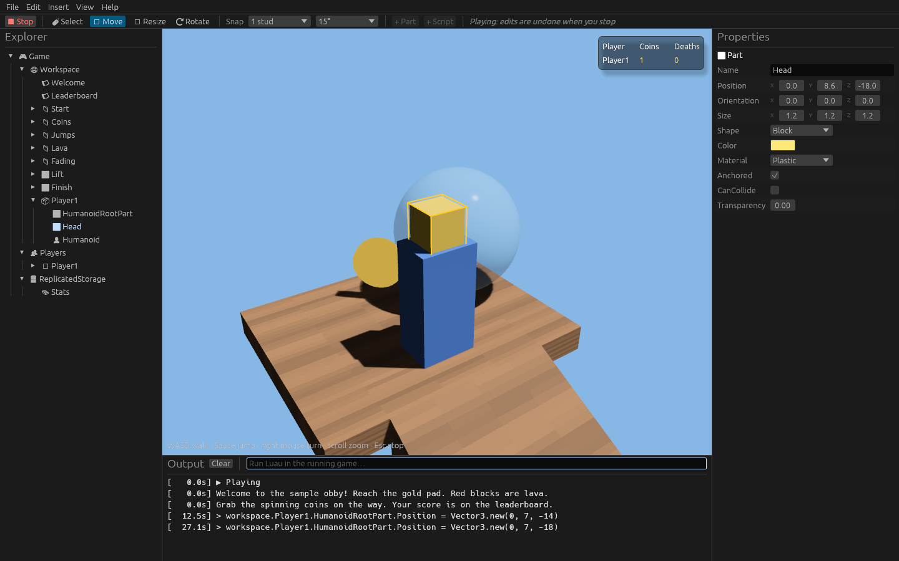

# Libroxel

**Build voxel worlds together, and script them in Luau.**

Libroxel is an open-source, multiplayer game-creation platform. Worlds are
built from blocks and parts, behaviour is written in [Luau](https://luau.org),
and the engine runs on [Bevy](https://bevy.org).

> **Status: early.** There is an editor where you can build a world, write
> scripts and press Play to test it with a character. Nothing is stable yet.




## Getting started

You need a recent stable Rust toolchain (`rustup update stable`).

On Arch Linux, Bevy's build needs a few system packages:

```sh
sudo pacman -S --needed base-devel pkgconf wayland libxkbcommon systemd-libs vulkan-icd-loader
# plus the Vulkan driver for your GPU, for example vulkan-radeon, vulkan-intel or nvidia-utils
```

On Debian or Ubuntu the equivalent is
`sudo apt install build-essential pkg-config libwayland-dev libxkbcommon-dev libudev-dev`.

Then:

```sh
cargo run -p libroxel-editor                      # the editor
cargo run -p libroxel-editor -- --sample          # the editor, with the sample obby open
cargo run -p libroxel-proto -- my_game.lrx        # play a saved game without the editor
cargo test --workspace                            # every test, no GPU needed
```

The first build compiles Bevy and takes a while. After that it is quick.

## The editor

- **File → Open sample obby** loads a small obstacle course with a wooden
  ramp, spinning coins, lava, fading platforms, a lift and a finish pad, plus
  a leaderboard that counts coins and deaths. Press **▶ Play** (or F5) to try it.
- **Explorer** (left) shows the instance tree. Click to select, double-click
  a script to edit it, drag one item onto another to move it inside, and
  right-click for Insert, Rename, Duplicate and Delete.
- **Properties** (right) edits the selection: name, position, orientation,
  size, shape, colour, material, anchored, can-collide, transparency, and so on.
- **Parts** come in four shapes (block, ball, cylinder, wedge) and eight
  materials (plastic, smooth plastic, neon, metal, glass, wood, brick, grass).
  Insert them from **+ Part** or the Insert menu.
- **Viewport:** hold the right mouse button and use WASD/QE to fly (Shift is
  faster), scroll to move forward. Click a part to select it, then drag the
  handles to move, resize or rotate it (Ctrl+1 to Ctrl+4 switch tools, and
  Ctrl+R turns the selection 90°). The two snap boxes set the grid step and
  the rotation step.
- **Play / Stop:** Play starts every Script, then you join as `Player1` and
  your character spawns at the first SpawnLocation. If scripts give you a
  `leaderstats` folder, the leaderboard shows it in the top-right corner. Walk with WASD, jump with Space, turn the camera with
  the right mouse button. Stop (or Esc) puts the world back as it was.
- **Output** (bottom) shows `print`, `warn` and script errors. While playing
  you can type Luau into its command bar and press Enter.
- **Undo/redo** with Ctrl+Z and Ctrl+Y. **Save** with Ctrl+S. Games are
  saved as `.lrx` files in `~/Projects/libroxel-games/` by default.

## Layout

| Crate | What it is |
| --- | --- |
| [`libroxel-instance`](crates/libroxel-instance) | The instance tree: classes, typed properties, parenting, destroy, a change journal, and the `.lrx` file format. No engine dependencies. |
| [`libroxel-script`](crates/libroxel-script) | The sandboxed Luau runtime (via `mlua`) with a thread scheduler. Every name scripts can see lives in [`names.rs`](crates/libroxel-script/src/names.rs). |
| [`libroxel-engine`](crates/libroxel-engine) | Play sessions: box physics, the player character, touch events, respawning, and the Bevy integration (rendering and cameras). |
| [`libroxel-editor`](crates/libroxel-editor) | The editor. |
| [`libroxel-proto`](crates/libroxel-proto) | A minimal player that runs a saved game or a single script. |

See [docs/ARCHITECTURE.md](docs/ARCHITECTURE.md) for how the pieces fit together.

## Scripting API

Scripts use a familiar scene-graph style: an `Instance` tree rooted at
`game`, a `workspace`, value types like `Vector3` and `Color3`, services from
`game:GetService`, and signals with `:Connect`. What exists today:

- **Globals:** `game`, `workspace`, `script`, `Instance.new(class, parent?)`,
  `Vector3.new/zero/one`, `Color3.new/fromRGB`, `Enum`, `require`, `print`,
  `warn`, `time()`, `task.wait`, `task.spawn`, `task.delay`, and `wait`.
- **Classes:** `Part`, `SpawnLocation`, `Model`, `Folder`, `Script`,
  `ModuleScript`, `Humanoid`, `IntValue`, `NumberValue`, `StringValue`,
  `BoolValue`, plus the built-in `Workspace`, `Players` (with one `Player`
  each) and `ReplicatedStorage`.
- **Instance members:** `Name`, `ClassName`, `Parent`, `FindFirstChild`,
  `FindFirstChildOfClass`, `WaitForChild`, `GetChildren`, `GetDescendants`,
  `IsA`, `IsDescendantOf`, `GetFullName`, `Clone`, `Destroy`, and
  `instance.ChildName`.
- **Part properties and events:** `Position`, `Orientation` (degrees),
  `Size`, `Shape` (`Enum.PartType`), `Color`, `Material` (`Enum.Material`),
  `Anchored`, `CanCollide`, `Transparency`, and the `Touched` event. Enum
  properties also accept a name, as in `part.Material = "Neon"`.
- **Modules:** a `ModuleScript` returns one value; `require(module)` runs it
  once and hands every caller the same value. Modules may `task.wait`.
- **Players:** `game:GetService("Players")` has `PlayerAdded`,
  `PlayerRemoving`, `GetPlayers()` and `GetPlayerFromCharacter(model)`. Each
  `Player` has `Name`, `UserId`, `Character` and a `CharacterAdded` event.
  A `leaderstats` folder of value objects inside a player shows up on the
  leaderboard.
- **Characters:** each player's character is a `Model` named after them with a
  `HumanoidRootPart` and a `Humanoid` (`Health`, `MaxHealth`, `WalkSpeed`,
  `JumpPower`, `TakeDamage(amount)` and the `Died` event). When health
  reaches 0 the character dies and respawns after two seconds.
- **Services:** `RunService.Heartbeat`, fired once per frame with the frame time.

A kill brick, for example:

```lua
script.Parent.Touched:Connect(function(hit)
	local humanoid = hit.Parent and hit.Parent:FindFirstChild("Humanoid")
	if humanoid then
		humanoid.Health = 0
	end
end)
```

Each script runs in its own sandboxed environment; the shared libraries are
read-only. A script that errors is reported in Output and never stops the
others.

A coin that counts on the leaderboard, using a module in ReplicatedStorage:

```lua
local Players = game:GetService("Players")
local Stats = require(game:GetService("ReplicatedStorage").Stats)

script.Parent.Touched:Connect(function(hit)
	local player = Players:GetPlayerFromCharacter(hit.Parent)
	if player then
		Stats.add(player, "Coins", 1)
	end
end)
```

**Not yet:** `CFrame`, GUIs, sounds, terrain and voxels, multiplayer, and
data saving. Physics is simple: anchored parts can be rotated and shaped
(ramps and balls work), but loose parts are upright boxes that fall and
stack without tipping over. Characters climb steps up to 0.6 studs.

## Contributing

Contributions are welcome. Please read [CONTRIBUTING.md](CONTRIBUTING.md)
first, especially the **clean-room rules**, and follow our
[Code of Conduct](CODE_OF_CONDUCT.md).

## License

Libroxel is dual-licensed under either of

- Apache License, Version 2.0 ([LICENSE-APACHE](LICENSE-APACHE))
- MIT License ([LICENSE-MIT](LICENSE-MIT))

at your option.

Unless you explicitly state otherwise, any contribution intentionally
submitted for inclusion in the work by you, as defined in the Apache-2.0
license, shall be dual licensed as above, without any additional terms or
conditions.
